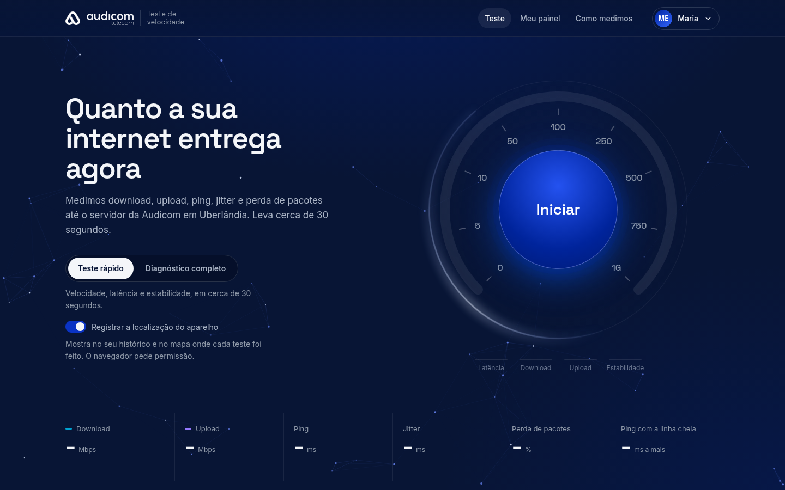
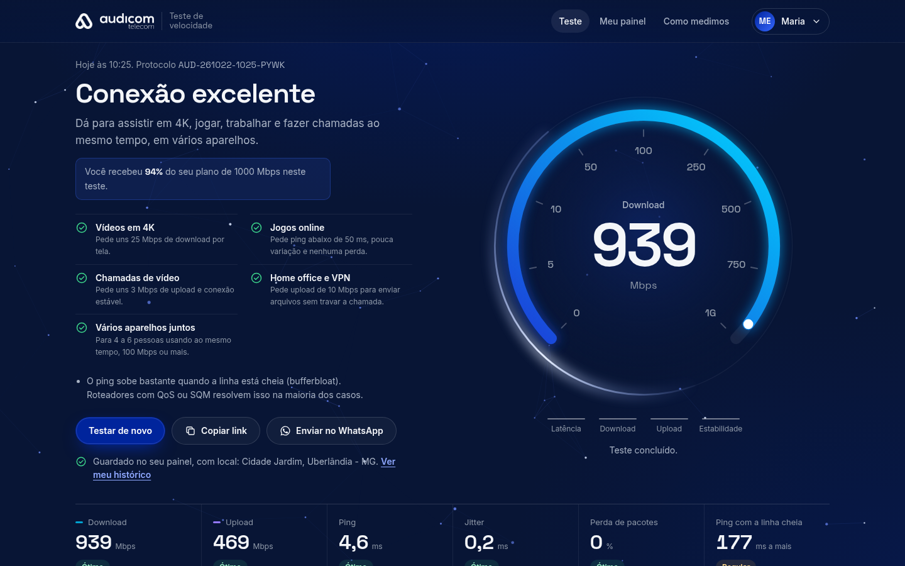
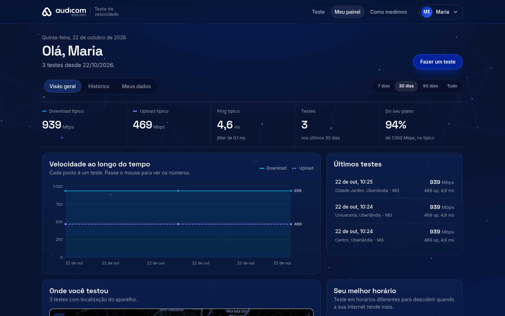
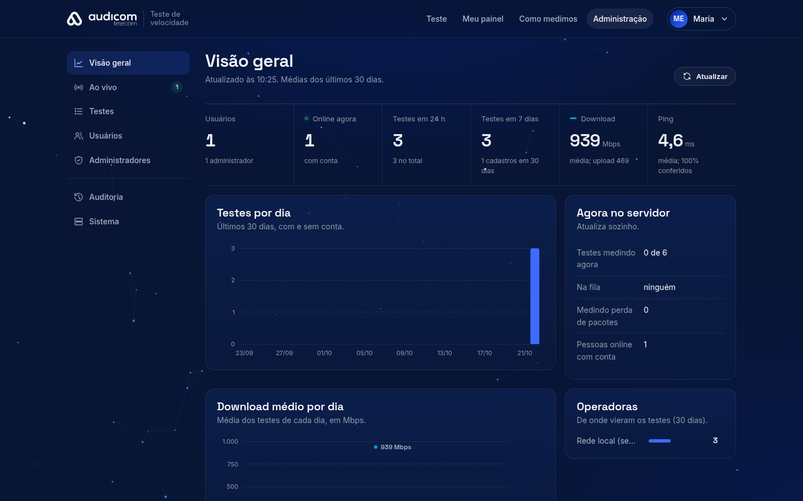

# Teste de velocidade Audicom

Teste de velocidade completo para provedores de internet, com **contas, histórico
com mapa e painel de administração ao vivo**. Tudo roda numa VM sua: um único
processo Node.js serve o site, mede a conexão e guarda contas e testes num banco
SQLite local. Sem Firebase, sem nuvem de terceiros, sem banco para instalar.



| Resultado | Meu painel |
|---|---|
|  |  |
| **Administração** | **No celular** |
|  |  |

---

## Instalar em um comando

Numa VM **Debian 12** ou **Ubuntu 22.04/24.04** crua, como root:

```bash
apt-get update && apt-get install -y curl     # o Debian mínimo não vem com curl
curl -fsSL https://raw.githubusercontent.com/davicjc/audicom-speedtest/main/server/tools/instalar.sh | bash
```

Abra `http://IP-DA-VM:8080`. Testado num Debian 12 mínimo recém-criado: cerca de
1 minuto, e os 24 testes automáticos passam na instalação nova. O passo a passo
completo (requisitos, administrador, domínio com HTTPS, instalação manual,
atualização) está em **[docs/INSTALAR.md](docs/INSTALAR.md)**.

---

## O que tem

**Teste** (`/`)
- Download, upload, ping, jitter, perda de pacotes (UDP de verdade, via WebRTC) e
  ping com a linha cheia (bufferbloat), medidos até o seu servidor.
- *Diagnóstico completo*: IPv4 × IPv6, NAT, duplo NAT e CGNAT, rota até o
  cliente, tempo até aplicativos, bancos e PIX, relógio do aparelho.
- Resultado em linguagem simples ("dá para 4K, jogos, home office?"),
  comparação com o plano contratado e protocolo `AUD-…`.
- **Enviar no WhatsApp / Copiar resultado** leva o relatório inteiro: velocidade,
  latência, operadora, IP, local, aparelho e, no diagnóstico completo, IPv4/IPv6,
  NAT, aplicativos, bancos, relógio e a rota salto a salto.

**Contas** (`/entrar`, `/cadastro`)
- Cadastro com captcha (próprio, sem serviço externo, ou Cloudflare Turnstile).
- "Manter conectado", confirmação de e-mail e "esqueci minha senha" (com SMTP,
  opcional).
- Teste feito sem login vai para a conta ao entrar (até 24 h).

**Meu painel** (`/painel`)
- Histórico, gráfico ao longo do tempo, mapa de onde a pessoa testou, melhor
  horário, comparação com o plano.
- Cada teste abre com **tudo o que foi medido**: curva de velocidade, latência
  detalhada, conexão, aparelho e o diagnóstico completo com a rota e os IPs.
- Aparelhos conectados (encerrar à distância), troca de senha.
- Baixar e excluir os próprios dados (LGPD).

**Administração** (`/admin`)
- Visão geral com médias, testes por dia, operadoras, cidades, horários e mapa.
- **Ao vivo**: quem está no site agora, quem está testando, testes e cadastros
  chegando na hora.
- Todos os testes de todos os usuários, com busca e planilha.
- Usuários: dar e tirar administrador, link de nova senha (com botão de
  WhatsApp), encerrar sessões, desativar, excluir.
- Auditoria de toda ação de administrador e estado do sistema.

**Speed Teste Técnico** (`/tecnico`): para técnicos e administradores, com
login. Mesmo teste, tema próprio (grafite e âmbar), todas as medidas sem filtro,
dados do atendimento (cliente, plano, observação) e a lista dos testes de todos
os clientes. A página do cliente coleta tudo, mas mostra o resultado em tom
honesto e sem alarme, para o teste não virar chamado por susto.

**SEO e estatísticas**: título, descrição, dados estruturados (schema.org),
perguntas frequentes, sitemap e robots gerados pelo servidor; Google Analytics 4
opcional, com faixa de cookies e consentimento (LGPD).

**Resultado público** (`/r/<id>`): o link que vai no WhatsApp, com prévia, sem
nome, IP nem localização.

---

## Como mede

| Medida | Como |
|---|---|
| Ping e jitter | eco por WebSocket num Web Worker, 30 amostras (mediana; jitter pela RFC 3550) |
| Download | 6 conexões HTTP paralelas, 10 s, descartando a partida |
| Upload | 4 envios paralelos, 10 s, **contado no servidor** (o navegador superestima) |
| Perda de pacotes | 200 pacotes UDP por WebRTC sem retransmissão |
| Linha cheia | ping durante o download e o upload (bufferbloat) |
| Conferência | o servidor marca como "não conferido" o resultado que não bate com o que ele entregou |

Conferido contra uma linha limitada em 940/470 Mbps: o teste mediu 938,7/468,8
Mbps. Detalhes em [server/README.md](server/README.md#o-que-é-medido-e-como) e na
página `/como-medimos`.

---

## Documentação

| Documento | Para quê |
|---|---|
| [docs/INSTALAR.md](docs/INSTALAR.md) | da VM crua ao site no ar: requisitos, instalador, HTTPS, manual, atualizar, remover |
| [docs/MANUAL.md](docs/MANUAL.md) | operação: `.env`, e-mail, captcha, administração, backups, segurança, LGPD, problemas, personalizar |
| [server/README.md](server/README.md) | técnico: módulos, banco, API, testes |

---

## Segurança, em resumo

- Senhas com **scrypt**; sessão em cookie **HttpOnly + SameSite** (`__Host-` e
  `Secure` em HTTPS); o banco guarda só o hash do token.
- Proteção contra CSRF, bloqueio de tentativas de login, captcha de uso único.
- Primeiro administrador só pelo terminal da VM; dono protegido; ações sensíveis
  pedem a senha de novo; auditoria.
- CSP por página sem script inline, HSTS, nada de arquivo interno servido (lista
  fechada).
- 24 testes automáticos cobrem a medição e a segurança: `cd server && npm test`.

Tabela completa na seção 13 do [MANUAL.md](docs/MANUAL.md#13-como-a-segurança-funciona).

---

## Estrutura

```
index.html, entrar.html, painel.html, admin.html, ...   páginas
css/          base.css (sistema visual) + um arquivo por página
js/core/      sessão e cliente da API, moldura das páginas, utilidades
js/engine/    motor de medição (Web Worker), orquestração do teste, captcha
js/ui/        velocímetro, constelação, gráficos SVG, mapa, detalhes do teste
js/pages/     script de cada página
vendor/       Leaflet (mapa), empacotado aqui (sem CDN)
assets/       marca, fontes próprias (sem Google Fonts), ícones, prévia
docs/         instalação, manual e capturas de tela
server/       servidor Node: medição, contas, banco, administração
server/tools/ instalar.sh, publicar.sh, servico.sh, admin.mjs
server/data/  banco, cópias de segurança e chaves (criado na instalação; fora do git)
```

**Tecnologia:** Node.js 22 (HTTP, WebSocket, `node:sqlite`), WebRTC
(`node-datachannel`) para o UDP, Caddy para o HTTPS, HTML/CSS/JS sem framework
no navegador.

---

## Rodar para desenvolver

```bash
git clone https://github.com/davicjc/audicom-speedtest.git
cd audicom-speedtest/server
npm ci
npm start                                       # http://localhost:8080
npm run admin -- dono voce@email.com "Seu Nome" # administrador
npm test                                        # testes automáticos
```

Requer Node 22.13 ou mais novo. Para a rota e o diagnóstico de NAT: `apt install
mtr-tiny tcpdump`.

---

## Personalizar

Nome, cidade, WhatsApp, telefone e e-mail do suporte vêm do `server/.env`;
logotipos ficam em `assets/`; cores em `css/base.css`. Lista completa na seção 19
do [MANUAL.md](docs/MANUAL.md#19-personalizar-para-o-seu-provedor).

Identidade visual da Audicom Telecom: azul estrutura `#081535`, azul conexão
`#00249C`, ciano `#00D4FF`; Space Grotesk nos títulos e números, Inter no texto.
As cores do download (`#00A3D1`) e do upload (`#9479FF`) nos gráficos foram
validadas para daltonismo.
