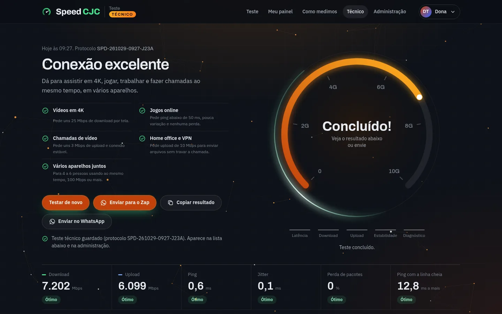
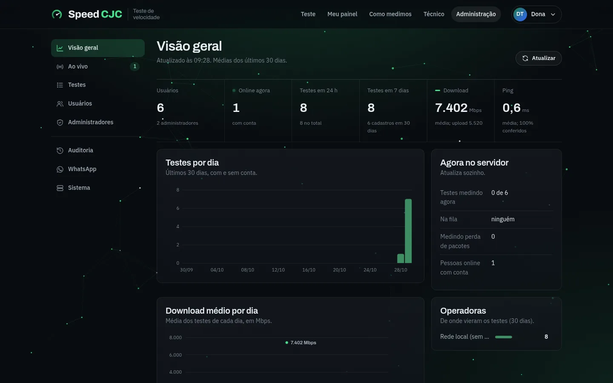

# Speed CJC

Teste de velocidade de internet completo, para rodar no **seu** servidor: site,
medição, contas, histórico com mapa, diagnóstico técnico e painel de
administração ao vivo. Um único processo Node.js faz tudo e guarda os dados num
banco SQLite local. Sem nuvem de terceiros, sem banco para instalar, sem
framework no navegador.

Feito para provedores de internet, empresas e técnicos de rede que querem um
teste próprio, com a própria marca, medindo até o próprio servidor.


| No celular | Diagnóstico técnico |
|---|---|
|  |  |
| **Área técnica** | **Administração** |
|  |  |

---

## Vídeo tutorial

[](https://github.com/Davicjc/Speed-CJC/releases/download/tutorial-speedcjc-v1/tutorial-speedcjc-completo.mp4)

O sistema inteiro em **7 min 59 s**, com narração e legendas em português
(1080p, dados fictícios). Clique na imagem para baixar e assistir o vídeo
completo, ou veja cada parte:

| Parte | Duração |
|---|---|
| [Parte 1 · Para o cliente](https://github.com/Davicjc/Speed-CJC/releases/download/tutorial-speedcjc-v1/tutorial-usuario.mp4): fazer o teste, entender o resultado e acompanhar no painel | 3 min 31 s |
| [Parte 2 · Para o técnico](https://github.com/Davicjc/Speed-CJC/releases/download/tutorial-speedcjc-v1/tutorial-tecnico.mp4): diagnóstico completo, atendimento e envio para o Zap | 2 min 14 s |
| [Parte 3 · Para a administração](https://github.com/Davicjc/Speed-CJC/releases/download/tutorial-speedcjc-v1/tutorial-admin.mp4): usuários, testes, técnicos, WhatsApp e o servidor | 2 min 14 s |

Todos os arquivos estão no
[release do vídeo tutorial](https://github.com/Davicjc/Speed-CJC/releases/tag/tutorial-speedcjc-v1).
Para gravar e gerar o vídeo de novo, veja [video-tutorial/README.md](video-tutorial/README.md).

---

## Sumário

1. [Baixar e instalar](#1-baixar-e-instalar)
2. [Primeiros passos depois de instalar](#2-primeiros-passos-depois-de-instalar)
3. [Colocar a sua marca](#3-colocar-a-sua-marca)
4. [O que tem](#4-o-que-tem)
5. [Como mede](#5-como-mede)
6. [Como funciona por dentro](#6-como-funciona-por-dentro)
7. [Segurança e LGPD](#7-segurança-e-lgpd)
8. [Estrutura das pastas](#8-estrutura-das-pastas)
9. [Desenvolver e testar](#9-desenvolver-e-testar)
10. [Ramos (branches) do repositório](#10-ramos-branches-do-repositório)
11. [Documentação completa](#11-documentação-completa)
12. [Créditos](#12-créditos)

---

## 1. Baixar e instalar

### O que você precisa

| Item | Mínimo | Recomendado |
|---|---|---|
| Sistema | Debian 12 ou Ubuntu 22.04/24.04 (VM ou máquina física) | Debian 12 |
| CPU e memória | 1 vCPU, 1 GB | 2 vCPU, 2 GB |
| Rede | a velocidade que você quer conseguir medir | 1 Gbps ou mais |
| Portas | TCP 8080 e UDP 8080 (na rede local) | TCP 80/443 + UDP 8080 para publicar com HTTPS |

O servidor precisa estar **perto de quem vai testar** (na rede do provedor, por
exemplo): o teste mede o caminho até ele.

### Opção A: um comando (recomendado)

Numa VM crua, como root:

```bash
apt-get update && apt-get install -y curl     # o Debian mínimo não vem com curl
curl -fsSL https://raw.githubusercontent.com/Davicjc/Speed-CJC/main/server/tools/instalar.sh | bash
```

O instalador:

1. instala as ferramentas de rede (`mtr`, `tcpdump`, `ping`, `ss`) e o Node.js 22,
   se a máquina não tiver;
2. baixa o projeto em `/opt/speed-cjc` (`git clone`);
3. instala as dependências do servidor (`npm ci`);
4. cria o serviço `speed-cjc` no systemd, que sobe sozinho com a máquina;
5. se o firewall `ufw` estiver ligado, libera TCP e UDP 8080.

Em cerca de 1 minuto o site está em `http://IP-DA-MAQUINA:8080`.

Já com o administrador e o HTTPS num domínio, tudo de uma vez:

```bash
curl -fsSL https://raw.githubusercontent.com/Davicjc/Speed-CJC/main/server/tools/instalar.sh \
  | bash -s -- --dominio teste.suaempresa.com.br --dono voce@suaempresa.com.br --dono-nome "Seu Nome"
```

Outras opções: `--pasta /outro/lugar`, `--repo URL`, `--so-preparar` (só
instala, não liga nada). Rodar de novo atualiza (faz `git pull`). Tudo em
[docs/INSTALAR.md](docs/INSTALAR.md#2-instalar-na-rede-local-um-comando).

### Opção B: baixar com git

```bash
git clone https://github.com/Davicjc/Speed-CJC.git /opt/speed-cjc
cd /opt/speed-cjc/server
npm ci --omit=dev           # dependências
cp .env.example .env        # configuração; edite com o seu nome e contatos
bash tools/servico.sh       # cria e liga o serviço speed-cjc
```

### Opção C: baixar o ZIP

No GitHub, **Code → Download ZIP**, descompacte no servidor e siga a opção B a
partir do `cd server`. Para atualizar depois, a opção B é mais prática
(`git pull`).

### Publicar na internet com HTTPS

Com um domínio apontando para o servidor:

```bash
bash /opt/speed-cjc/server/tools/publicar.sh --dominio teste.suaempresa.com.br
```

Ele instala o Caddy, pede o certificado (Let's Encrypt), ajusta o `.env` e
confere tudo no fim. Detalhes, DNS e portas: [docs/INSTALAR.md](docs/INSTALAR.md#4-publicar-na-internet-com-https).

### Atualizar

```bash
cd /opt/speed-cjc && git pull && cd server && npm ci && npm test && systemctl restart speed-cjc
```

O banco, as chaves e o `.env` ficam em `server/data/` e `server/.env`, fora do
git: atualizar não apaga nada.

---

## 2. Primeiros passos depois de instalar

1. **Crie o administrador principal** (o "dono"). Por segurança, só pelo
   terminal do servidor:

   ```bash
   cd /opt/speed-cjc/server
   npm run admin -- dono voce@suaempresa.com.br "Seu Nome"
   ```

   Ele mostra um link para você criar a senha.
2. Abra `http://IP-DA-MAQUINA:8080`, entre e confira **Administração → Sistema**.
3. Ponha o seu nome e os seus contatos no `server/.env` (próxima seção) e
   reinicie: `systemctl restart speed-cjc`.
4. Quando quiser abrir para o público: domínio + `publicar.sh` (acima).
5. Opcional: e-mail (SMTP) para confirmação de cadastro e "esqueci a senha",
   Google Analytics, WhatsApp dos técnicos. Tudo em [docs/MANUAL.md](docs/MANUAL.md).

---

## 3. Colocar a sua marca

O Speed CJC vem com um visual neutro, nas cores de [davicjc.com](https://davicjc.com):
grafite, verde de LED e âmbar, com as fontes Archivo e IBM Plex Sans. Trocar
para a sua marca não exige mexer em código.

**Nome, empresa e contatos**: no `server/.env`

| Variável | Para quê | Exemplo |
|---|---|---|
| `SITE_NAME` | nome do site: título das páginas, menu, app instalável, e-mails, WhatsApp | `Speed Minha Net` |
| `SERVER_NAME` | empresa que opera o servidor: rodapé, privacidade, termos, relatórios | `Minha Net Telecom` |
| `SERVER_LOCATION` | cidade do servidor ("até o nosso servidor em …") | `Campinas, SP` |
| `LEGAL_FORO` | foro dos termos de uso (vazio = domicílio do consumidor) | `Campinas, SP` |
| `PROTOCOL_PREFIX` | prefixo do protocolo de cada teste | `MNT` → `MNT-261029-1530-7B8L` |
| `SUPPORT_WHATSAPP`, `SUPPORT_PHONE`, `SUPPORT_EMAIL`, `SUPPORT_SITE`, `SUPPORT_CENTRAL`, `SUPPORT_ADDRESS` | contatos do rodapé e da política de privacidade; o que ficar vazio não aparece | `5519999999999` |

**Logo e ícones**: troque os arquivos em `assets/`, com os mesmos nomes:
`logotipo.webp` (topo e rodapé), `simbolo.webp` (ícone ao lado do nome),
`icone-192.png` e `icone-512.png` (app instalável), `og.png` (prévia de 1200×630
no WhatsApp e redes sociais) e `favicon.ico` na raiz.

**Cores e fontes**: em `css/base.css`, nos tokens do início do arquivo
(`--navy-*` para os fundos, `--azul` para os botões, `--ciano` para o destaque,
`--velo-*` para o velocímetro). O tema da área técnica fica em `css/tecnico.css`.

As páginas usam marcações que o servidor troca na hora de entregar
(`{{MARCA}}`, `{{EMPRESA}}`, `{{EM_CIDADE}}`, `{{CONTATO_HTML}}`, `{{FORO}}`).
Política de privacidade e termos de uso já saem com a sua empresa, mas são um
modelo: leia e passe pelo seu jurídico.

---

## 4. O que tem

**Teste** (`/`)
- Download, upload, ping, jitter, perda de pacotes (UDP de verdade, via WebRTC)
  e ping com a linha cheia (bufferbloat), medidos até o seu servidor.
- Velocímetro com escala que acompanha a conexão (50, 100, 200 … 10G).
- **Diagnóstico completo**: IPv4 × IPv6, tipo de NAT, duplo NAT e CGNAT, tempo
  até aplicativos, streaming (YouTube, Netflix, Globoplay, Prime Video, Disney+,
  HBO Max, Spotify, Twitch), TV ao vivo (Claro TV+, SKY+, Watch Brasil, Zapping,
  Pluto TV, Samsung TV Plus), bancos e PIX, e o relógio do aparelho.
- Resultado em linguagem simples ("dá para 4K, jogos, home office?") e
  comparação com o plano contratado.
- **Copiar** e **Enviar no WhatsApp** com o relatório inteiro, organizado com
  emojis.
- No celular, a tela mostra só o teste e os botões; convite para instalar como
  app (Android, iPhone, computador), com o passo a passo de cada navegador.
- Sem conta: até 6 testes por dia em cada aparelho.

**Contas** (`/entrar`)
- Cadastro com captcha próprio (sem serviço externo) ou Cloudflare Turnstile.
- "Manter conectado", confirmação de e-mail e "esqueci minha senha" (com SMTP,
  opcional). O teste feito sem conta vai para a conta ao entrar.

**Meu painel** (`/painel`)
- Histórico, gráfico, mapa de onde a pessoa testou, melhor horário, comparação
  com o plano. Cada teste abre com tudo o que foi medido.
- Aparelhos conectados, troca de senha, baixar e excluir os próprios dados (LGPD).

**Área técnica** (`/tecnico`), para técnicos e administradores
- Tema próprio (grafite e âmbar) e todas as medidas, sem filtro.
- Dados do atendimento (cliente, plano, observação) guardados com o teste.
- No diagnóstico completo, também **MTU e MSS** (com o aviso de MSS maior que o
  caminho) e a **rota salto a salto** até o cliente.
- Lista e busca dos testes de todos os clientes.
- **Enviar para o Zap**: manda o teste, com até 6 fotos, para os grupos que a
  administração liberou.

**Administração** (`/admin`)
- Visão geral, **ao vivo** (quem está no site e testando agora), todos os testes
  com busca e planilha, usuários (administrador, técnico, desativar, link de
  nova senha), auditoria, sistema.
- **WhatsApp**: conectar por QR code, escolher os destinos e o que vai em cada
  mensagem.

**Resultado público** (`/r/<id>`): o link que vai no WhatsApp, com prévia, sem
nome, IP nem localização. **SEO**: dados estruturados, perguntas frequentes,
sitemap e robots gerados pelo servidor; Google Analytics opcional, só depois do
aceite de cookies.

---

## 5. Como mede

| Medida | Como |
|---|---|
| Ping e jitter | eco por WebSocket num Web Worker, 30 amostras (mediana; jitter pela RFC 3550) |
| Download | 6 conexões HTTP paralelas, 10 s, descartando a partida |
| Upload | 4 envios paralelos, 10 s, **contado no servidor** (o navegador superestima) |
| Perda de pacotes | 200 pacotes UDP por WebRTC, sem retransmissão |
| Linha cheia (bufferbloat) | ping durante o download e o upload |
| Conferência | o servidor marca como "não conferido" o resultado que não bate com o que ele entregou |
| Aplicativos, streaming, IPTV, bancos | tempo até o servidor de borda (CDN) de cada plataforma; endereços conferidos a cada 6 h |
| Tipo de NAT | STUN de dois provedores diferentes pela mesma porta: porta igual = moderado (tipo 2), diferente = estrito (tipo 3) |
| Duplo NAT | TTL dos pacotes do aparelho comparado com o TTL do ping no roteador do cliente: a diferença é o número de roteadores na casa |
| MTU | ping com "não fragmentar" até o cliente, em busca binária (como o `ping -f -l` feito à mão) |
| MSS | lido da própria conexão TCP do cliente (`ss`), com o desconto das opções TCP |
| Rota | `mtr` do servidor até o cliente |

Detalhes, limites e como interpretar: [docs/MANUAL.md](docs/MANUAL.md) (seções
25 a 27), [server/README.md](server/README.md) e a página `/como-medimos` do
próprio site.

---

## 6. Como funciona por dentro

```
 navegador (HTML/CSS/JS, sem framework)            servidor (um processo Node.js 22)
 ───────────────────────────────────────           ─────────────────────────────────────────
 página do teste ── HTTP (download/upload) ──────▶ medição e conferência
 Web Worker      ── WebSocket (ping, vaga) ──────▶ fila de testes, relógio, presença
                 ── WebRTC/UDP (perda) ──────────▶ eco UDP (node-datachannel)
 painel, admin   ── API JSON + cookie de sessão ─▶ contas, testes, auditoria ── SQLite (node:sqlite)
                                                   mtr, tcpdump, ping, ss ── rota, duplo NAT, MTU/MSS
                                                   processo separado ── WhatsApp (Baileys), opcional
 internet ─▶ Caddy (HTTPS, certificado automático) ─▶ porta 8080
```

- **Um processo só** (`speed-cjc`) serve o site, mede e guarda. O WhatsApp roda
  num processo à parte: se ele cair, o teste continua.
- **Banco**: um arquivo, `server/data/speedcjc.db`, com cópia de segurança
  diária em `server/data/backups/`.
- **Sem dependência externa obrigatória**: fontes, mapa (Leaflet) e captcha são
  servidos pelo próprio servidor.

---

## 7. Segurança e LGPD

- Senhas com **scrypt**; sessão em cookie **HttpOnly + SameSite** (`__Host-` e
  `Secure` em HTTPS); o banco guarda só o hash do token.
- Proteção contra CSRF, bloqueio de tentativas de login, captcha de uso único,
  limite de testes sem conta (com hashes, sem guardar o IP).
- Primeiro administrador só pelo terminal; dono protegido; ações sensíveis pedem
  a senha de novo; auditoria de toda ação de administrador.
- CSP por página sem script inline, HSTS, lista fechada de arquivos servidos.
- LGPD: política de privacidade, consentimento de cookies, baixar e excluir os
  próprios dados, testes sem conta apagados depois do prazo, fotos do WhatsApp
  sem metadados e não gravadas.
- 27 testes automáticos cobrem a medição e a segurança: `cd server && npm test`.

Tabela completa na seção 13 do [MANUAL.md](docs/MANUAL.md#13-como-a-segurança-funciona).

---

## 8. Estrutura das pastas

```
index.html, entrar.html, painel.html, tecnico.html, admin.html, ...   páginas
css/          base.css (sistema visual e tokens de cor) + um arquivo por página
js/core/      sessão e cliente da API, moldura das páginas, marca, utilidades
js/engine/    motor de medição (Web Worker) e orquestração do teste
js/ui/        velocímetro, gráficos, mapa, relatório, diagnóstico, WhatsApp
js/pages/     script de cada página
vendor/       Leaflet (mapa), empacotado aqui (sem CDN)
assets/       logo, símbolo, ícones, fontes e imagem de prévia
docs/         instalação, manual e capturas de tela
server/src/   servidor: medição, contas, banco, administração, NAT, MTU, WhatsApp
server/tools/ instalar.sh, publicar.sh, servico.sh, admin.mjs
server/deploy/ modelos do serviço (systemd) e do Caddy
server/data/  banco, cópias e chaves (criado na instalação; fora do git)
```

---

## 9. Desenvolver e testar

```bash
git clone https://github.com/Davicjc/Speed-CJC.git
cd Speed-CJC/server
npm ci
npm start                                       # http://localhost:8080
npm run admin -- dono voce@email.com "Seu Nome" # administrador
npm test                                        # 27 testes automáticos
```

Requer Node 22.13 ou mais novo. Para a rota, o duplo NAT e o MTU:
`apt install mtr-tiny tcpdump iputils-ping iproute2` (e rodar como root, ou com
as permissões de rede para essas ferramentas).

---

## 10. Ramos (branches) do repositório

| Ramo | O que é |
|---|---|
| `main` | o **Speed CJC** genérico, com as cores de davicjc.com, para qualquer um usar e personalizar |
| `audicom-telecom` | a versão em produção na Audicom Telecom, com a identidade visual e os dados dela |

Para baixar um ramo específico: `git clone --branch audicom-telecom https://github.com/Davicjc/Speed-CJC.git`.

---

## 11. Documentação completa

| Documento | Para quê |
|---|---|
| [docs/INSTALAR.md](docs/INSTALAR.md) | da VM crua ao site no ar: requisitos, instalador, HTTPS, instalação manual, atualizar, remover |
| [docs/MANUAL.md](docs/MANUAL.md) | operação: `.env`, e-mail, captcha, administração, backups, segurança, LGPD, personalizar, técnico, WhatsApp, NAT e MTU |
| [server/README.md](server/README.md) | técnico: módulos, banco, API, testes |
| [server/.env.example](server/.env.example) | todas as configurações, comentadas |

---

## 12. Créditos

Criado por **Davi Castro** ([davicjc.com](https://davicjc.com)).

Usa [Leaflet](https://leafletjs.com) (mapa), [node-datachannel](https://github.com/murat-dogan/node-datachannel)
(WebRTC/UDP), [Baileys](https://github.com/WhiskeySockets/Baileys) (WhatsApp),
[Caddy](https://caddyserver.com) (HTTPS) e as fontes [Archivo](https://fonts.google.com/specimen/Archivo)
e [IBM Plex Sans](https://fonts.google.com/specimen/IBM+Plex+Sans) (SIL Open Font
License).
